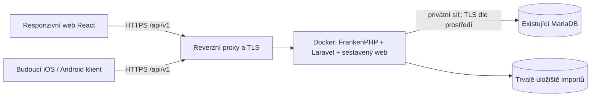

# CCM — technologie a technická koncepce

Stav: doporučené technické řešení, 20. 10. 2026. Navazuje na [cílový koncept](cilovy-koncept.md), [případy použití](program/pripady-pouziti.md) a [implementační plán](postup-implementace.md). Dokument specifikuje budoucí realizaci; nevytváří aplikaci, kontejnery ani nasazovací skript.

## 1. Doporučený technologický základ

| Oblast | Doporučení | Důvod |
|---|---|---|
| Backend a API | PHP 8.4, Laravel 13 | Ucelené řešení validací, autorizace, transakcí, migrací, autentizace a úloh na pozadí |
| Přístup k datům | Eloquent a Laravel Query Builder | Běžná evidence přes modely, agregace přes cílené databázové dotazy |
| Databáze | Existující externí MariaDB, InnoDB, utf8mb4 | Navazuje na uživatelův server a již navržený relační model |
| Webový klient | React 19, TypeScript, Vite | Samostatný klient téhož API, které později využijí mobilní aplikace |
| Vzhled | Tailwind CSS 4, přístupné komponenty nad Radix UI | Responzivní formuláře, jednotné ovládání a dostupnost z klávesnice |
| Komunikace a formuláře | TanStack Query, React Hook Form, Zod | Stav serverových dat, formuláře a klientská validace; rozhodující validace je na serveru |
| Grafy | Recharts | Vývoj spotřeby a členění výdajů s textovým/tabulkovým ekvivalentem |
| API kontrakt | REST/JSON, OpenAPI 3.1 | Dokumentovatelný kontrakt a generování typovaného klienta |
| Autentizace | Laravel Sanctum | Webové sessions a samostatně spravované tokeny mobilních zařízení |
| Aplikační runtime | FrankenPHP v klasickém režimu | PHP a HTTP server v jednom aplikačním kontejneru; bez trvale běžících aplikačních workerů v první verzi |
| Nasazení | Docker Engine a Docker Compose v2 | Opakovatelné sestavení a provoz na jednom serveru |
| Ověření | PHPUnit/Pest, Vitest, React Testing Library, Playwright | Doménové, integrační, klientské a průchozí testy |
| Automatické kontroly | GitHub Actions, PHPStan/Larastan, Pint, ESLint, TypeScript | Kontrola změn před nasazením |

Uvedené hlavní verze jsou návrhový cíl, nikoli tvrzení o nejnovějších vydáních nebo již provedeném ověření kompatibility. Při založení projektu se ověří podpora PHP, frameworku, balíčků a runtime a zvolí konkrétní udržované patch verze. Composer a npm lock soubory budou součástí repozitáře; obrazy budou mít pevné verze, případně digest. Aktualizace závislostí budou samostatně ověřované změny.

Node.js v podporované LTS verzi je potřeba pro sestavení klienta, ne pro běh produkční aplikace. První verze nepotřebuje Redis, Kubernetes ani samostatné mikroslužby. Jedna aplikace, jedna externí databáze a jeden repozitář odpovídají očekávanému rozsahu.

## 2. Architektura

Aplikace bude modulární monolit: jedna nasazovaná backendová aplikace s jasně oddělenými funkčními oblastmi. Web bude React SPA servírovaná z téhož původu jako API. Pro interní evidenci není nutné serverové vykreslování ani SEO framework.

Na hostiteli se předpokládá reverzní proxy s HTTPS. Lze použít již existující; pokud chybí, doplní se Caddy jako samostatná infrastrukturní služba. Aplikační port bude dostupný pouze proxy, nikoli veřejně bez TLS. Produkční Compose nebude zakládat ani aktualizovat databázový server.

Moduly: účty a přístup, vozidla a média, tankování, výdaje a opakování, import/export, statistiky a audit. Uvnitř se oddělí HTTP rozhraní a validace, aplikační operace, doménová pravidla a databázový přístup. Výpočet spotřeby bude samostatná testovatelná služba bez závislosti na webovém formuláři.

Ruční zápis, CSV import i mobilní klient použijí stejné aplikační operace a pravidla. Výpočty, vlastnictví, částky a duplicity nesmějí být řešeny pouze v JavaScriptu. Controller pouze přijme požadavek, zavolá operaci a vrátí dokumentovanou odpověď.

Repozitář bude obsahovat backend, klienta, testy, API kontrakt, dokumentaci a nasazovací podklady. Doporučené členění: standardní Laravel adresáře, web v resources/js, doménové moduly v app, migrace a číselníky v database, automatické testy v tests a provozní soubory v deploy. Konkrétní soubory vzniknou až při implementaci.

## 3. Databázový server a kompatibilita

Uvedený server **10.5.28-MariaDB-ubu2004 je MariaDB**, nikoli Oracle MySQL. Používá kompatibilní připojovací protokol; aplikace však bude ověřovaná proti MariaDB. Současnou podporu Oracle MySQL neslibujeme, protože se liší například JSON, kolace a některé chování migrací.

Současná řada 10.5 je pro nové dlouhodobé produkční nasazení zastaralý základ. Doporučení je upgrade na podporovanou MariaDB LTS řadu, například 11.8 LTS, s výběrem konkrétní verze podle aktuální podpory a serverového prostředí při realizaci. Označení „aktuální“ zde znamená podporovanou stabilní řadu, nikoli automatické stahování latest.

Schéma první verze nebude záměrně vyžadovat funkce nad rámec 10.5: přesné DECIMAL, běžné FK, transakce, kompatibilní kolace utf8mb4_unicode_ci a textové auditní snímky. Přechodný provoz na 10.5 je podmíněn integračním ověřením konkrétního ovladače, migrací a dotazů, nikoli garantován pouze tímto návrhem. Přednost má upgrade před produkčním spuštěním. Pokud je přechodný provoz nutný, musí automatické databázové testy pokrývat 10.5 i cílovou LTS verzi.

Upgrade sdíleného DB serveru je samostatná infrastrukturní operace mimo deploy CCM: inventura ostatních aplikací, záloha a ověřená obnova, zkouška upgradu na kopii a postup podle podporovaných upgrade cest MariaDB. Není bezpečné předpokládat libovolný přímý skok mezi verzemi. Přípona ubu2004 sama nedokazuje aktuální OS hostitele; kompatibilita balíčků a OS se ověří zvlášť.

CCM dostane vlastní databázi. Runtime účet má jen oprávnění nutná pro aplikaci; migrace používají oddělený účet s DDL oprávněními pouze nad databází CCM. Nepoužívá se root ani sdílené přihlašovací údaje jiné aplikace. DB je dostupná pouze ze serveru aplikace přes privátní síť/VPN nebo omezená pravidla firewallu; pokud spojení opouští důvěryhodný host, použije se TLS s ověřením certifikátu.

Připojení se nastaví za běhu přes DB_HOST, DB_PORT, DB_DATABASE, DB_USERNAME, DB_PASSWORD a případnou cestu k CA certifikátu. V kontejneru localhost neoznačuje databázi běžící na hostiteli. Pro DB na stejném Linux serveru se výslovně nastaví dostupná adresa hostitele a bind/firewall; pro vzdálenou DB privátní DNS nebo IP. Hesla nejsou součástí Git, Docker image ani sestavovacích argumentů.

## 4. API a příprava mobilních aplikací

Veškeré funkce webu budou dostupné přes verzované API /api/v1. Oblasti kontraktu: profil a autentizace, číselníky, vozidla a média, tankování, výdaje, historie/audit, importní dávky, export a statistiky. Nahrání, validace, potvrzení a vrácení importu jsou samostatné operace; klient nemá přímý přístup do DB ani k interním souborům.

Kontrakt určí filtry, povolená řazení, stránkování, oprávnění, jednotky a chybové odpovědi. Serverové stránkování je povinné pro historie i náhled importu. ID typu BIGINT se v JSON přenášejí jako řetězce kvůli přesnosti JavaScriptu. Částky, množství a další přesná desetinná data se přenášejí jako desetinné řetězce s tečkou; klient je lokalizuje až při zobrazení. API datum události používá YYYY-MM-DD, technické časy ISO 8601 v UTC. CSV má nadále vlastní formát DD.MM.YYYY a desetinnou čárku.

Standardní odpovědi zahrnou 401 pro nepřihlášeného, 404 pro neexistující nebo nepřístupný objekt, 422 s chybami polí a 409 pro konflikt revize či neplatný stav dávky. Klient při změně odešle očekávanou revision. Vytváření finančních záznamů a potvrzení importů použije idempotency key s uložením výsledku a kontrolou shody obsahu; opakování síťového požadavku tak neznamená druhou platbu. Tato ochrana nenahrazuje vyhledání obchodních duplicit.

OpenAPI je verzovaný kontrakt v repozitáři; změny kontrolují testy. React klient získá typy a klienta z kontraktu. Změny v rámci v1 budou zpětně kompatibilní, protože mobilní aplikaci nelze aktualizovat současně se serverem. API nesmí záviset na konkrétním tvaru obrazovek webu.

Budoucí nativní aplikace použijí stejné API. Konkrétní mobilní technologie se vybere až při zahájení mobilního vývoje; není nutné ji volit nyní. První verze je online. Offline zápis a synchronizace by vyžadovaly zvláštní návrh konfliktů, klientských identifikátorů a změnového protokolu; samotné REST API ani PWA je nezajišťuje.

## 5. Přihlášení a ochrana dat

Pro web: Laravel session a Sanctum, Secure/HttpOnly cookies, nastavení SameSite a CSRF ochrana všech měnících operací. Web a API jsou na stejné doméně; není potřeba plošné CORS. Tokeny se ve webu neukládají do localStorage.

Pro budoucí vlastní mobilní klienty: Sanctum bearer token pro každé zařízení, uložený na telefonu v iOS Keychain / Android Keystore. Přenos pouze přes HTTPS, na serveru uložený otisk tokenu, omezená platnost, revokace zařízení a rate limiting přihlašování. Přihlášení vydávající token se doplní a otestuje při zavedení mobilního klienta; nelze jen znovu použít cookie/CSRF postup webu. Pokud vznikne potřeba přístupu aplikací třetích stran nebo jednotného přihlašování, zavede se OAuth/OIDC s Authorization Code + PKCE; Sanctum se za OAuth server nevydává.

Pro první soukromé nasazení doporučujeme zakládat účty správcem a nemít veřejnou registraci. Hesla budou hashována frameworkovým mechanismem. Pozdější obnova hesla vyžaduje nakonfigurované odesílání e-mailu. Každý dotaz i agregace ověřuje vlastnictví přes Laravel Policies a filtrovaný kontext vlastníka; znalost ID vozidla není oprávnění.

Produkce nebude zobrazovat ladicí výpisy. Importní obsah se bere jako data, ne jako HTML či instrukce. Audit a raw CSV jsou neveřejné. Limity uploadů a oprávnění se ověřují i při stažení exportu. Strukturované logy neobsahují hesla, bearer tokeny ani kompletní poznámky z importů.

## 6. Responzivní web

Návrh bude vycházet z mobilních displejů, přibližně od šířky 360 px. Hlavní akce „Přidat tankování“ a „Přidat výdaj“ budou dostupné přímo u vybraného vozidla. Formuláře budou mít velké dotykové cíle, vhodné klávesnice pro čísla, jasné jednotky a rozbalitelné pokročilé údaje.

Na mobilu se historie zobrazí jako přehledné karty, na větších displejích jako tabulka. Filtry a grafy budou použitelné dotykem; zásadní údaje nesmějí být dostupné jen při najetí myši. Ovládání musí fungovat z klávesnice, mít popisky a srozumitelná chybová hlášení, s cílem WCAG 2.2 AA.

České formátování čísel a dat bude oddělené od API reprezentace. Jednotky a měna budou vždy viditelné. Volitelně lze později doplnit instalovatelnou PWA; první verze nebude pomocí service workeru ukládat soukromé odpovědi API do offline cache.

## 7. Import, export a výpočty

CSV bude zpracovávat backend proudově, nikoli načtením celého souboru do browseru. Zvolená knihovna či parser musí testy prokázat kompatibilitu s escapováním obou dodaných příloh; obecné označení CSV kompatibilitu nezaručuje. Autoritativní specifikace je v [dokumentaci CSV](program/csv-import-export.md).

První verze může zpracovat omezené dávky synchronně s explicitním limitem souboru, řádků a času. Pro větší dávky lze stejnou operaci spustit jako úlohu na pozadí: Laravel database queue a worker ze stejného image, bez nutnosti Redis. Stav úlohy se zobrazí přes API. Worker se přidá až podle ověřených objemů, ne jako povinný základ.

Potvrzení dávky zůstává atomické v rámci přijatého limitu a kontroluje stav dávky pod zámkem. Velké soubory se nesmějí tiše rozdělit na částečně potvrzené importy. Souběžné potvrzení téže dávky se serializuje; vyhledání shod s jinými dávkami téhož vozidla se před zápisem znovu ověří. Souběžné zápisy historie a kontrola revizí budou řešeny transakcemi a databázovými zámky v kritických operacích.

Importní podklady budou v trvalém neveřejném úložišti pod interními názvy a zároveň s dohledatelnými raw záznamy v DB podle konceptu. Export bude generován proudově ze stejných autorizovaných dat a zachová společnou strukturu. Vypočtená spotřeba nenahradí původní Consumption při exportu.

Peníze a spotřeba se na backendu počítají pomocí přesné desetinné aritmetiky (například brick/math), nikoli PHP float. Agregace peněz v DB používají DECIMAL. Výpočty intervalů se zpočátku provádějí nad potřebnou seřazenou historií bez trvalé cache; optimalizace či uložené odvozené hodnoty se doplní až podle měření. Každá změna historie se tím promítne i do navazujících intervalů, včetně obnovy a vrácení dávky.

## 8. Docker a sestavení

Budoucí repozitář doplní vícefázový Dockerfile, produkční Compose, konfigurační šablonu bez tajných hodnot a deploy skript. PHP závislosti a React klient se sestaví oddělenými build fázemi. Výsledný image obsahuje aplikaci, produkční PHP závislosti a hotové statické soubory, nikoli Node.js nástroje, Git credentials nebo vývojové balíčky.

Kontejner poběží jako neprivilegovaný uživatel. Zdrojové soubory se nebudou do produkce připojovat z pracovního checkoutu. Trvalé úložiště importů bude samostatný volume nebo spravovaná adresářová přípojka, logy půjdou na stdout/stderr. Sessions a případná queue mohou být v DB; stabilní APP_KEY se uchovává jako tajná konfigurace a negeneruje znovu při každém deployi.

Kontrola živosti ověří běh aplikace, kontrola připravenosti navíc připojení k DB a očekávanou verzi schématu. Při výpadku DB se nehlásí úspěšná připravenost. Start běžné instance automaticky nespouští migrace; ty jsou jednorázovým řízeným krokem deploye.

## 9. Navržený průběh deploy skriptu

Skript poběží na cílovém serveru s Docker/Compose a přístupem k repozitáři. Vstupem bude konkrétní release tag nebo commit; ne neurčená aktuální větev. Git přístup (například read-only deploy key) a runtime konfigurace jsou uloženy mimo repozitář. Nasazení soukromého repozitáře nesmí vyžadovat vložení tokenu do Dockerfile nebo URL v logu.

1. Získat zámek nasazení, zkontrolovat nástroje, konfiguraci, dostupnost DB, místo na disku a dostupnost potřebných image registrů/balíčků.
2. Stáhnout z MartinDejmal/ccm požadovaný commit do samostatného release checkoutu. Zachovat předchozí release a nepřepisovat lokální secrets.
3. Sestavit image podle lock souborů a označit jej commit SHA. Sestavení pracuje bez produkčních DB přihlašovacích údajů. Produkční nasazení bude přijímat jen release, který prošel automatickými kontrolami.
4. Před změnou schématu ověřit existenci použitelné zálohy databáze CCM a importních podkladů. Záloha není automaticky záloha celého sdíleného DB serveru.
5. Podle typu změny omezit zápisy a případně přepnout aplikaci do údržby. Novým image jednorázově provést migrace a doplnění číselníků s oddělenými oprávněními. Doplnění nesmí mazat uživatelská data.
6. Spustit novou verzi aplikace se stabilními volumes a konfigurací a případně obnovit worker. Zapojit do proxy až po úspěšné kontrole připravenosti; v jednoduchém režimu lze akceptovat krátkou plánovanou odstávku.
7. Provést krátké ověření dostupnosti webu, API a verze release. Ukončit údržbu a zaznamenat nasazený commit, verzi schématu a výsledek bez tajných údajů.
8. Při chybě ponechat či obnovit původní image, pokud je kompatibilní se schématem. Při nekompatibilní změně ukončit automatický rollback a použít předem připravený postup obnovy; data neobnovovat bez ohledu na mezitím vzniklé zápisy.

Migrace MariaDB mohou provádět implicitní commity; nelze slíbit, že selhanou změnu celého schématu automaticky vrátí transakce. Preferují se přídavné a zpětně kompatibilní změny (nejprve rozšířit, později odstranit), nikoli automatické destruktivní down migrace při návratu image. Upgrade databázového serveru není součástí skriptu. Compose na jednom hostiteli samo negarantuje nasazení bez výpadku.

Tento postup odpovídá požadavku „stáhnout repozitář, sestavit Docker a připojit se k existující DB“. Později lze místo sestavování na serveru stahovat již ověřený image z registru; není to podmínkou první verze.

## 10. Ověření a provoz

Doménové testy pokryjí spotřebu, intervaly, měny, přesnost a plány. Integrační testy poběží proti skutečné MariaDB, nikoli pouze SQLite: transakce, FK, revize, souběžné potvrzení dávky a migrace se jinak chovají odlišně. API testy pokryjí přihlášení, vlastnictví dvou uživatelů, idempotenci a konflikty. CSV testy ověří obě přílohy, kontrolní součty, zpětný export/import a odlišné profily nulových BC údajů. Playwright projde sedm případů použití na mobilním i desktopovém rozměru.

GitHub Actions před releasem ověří testy, statickou analýzu, sestavení klienta a Docker image. Zálohování je provozní úloha mimo životní cyklus kontejneru a jeho obnovu je nutné vyzkoušet. Logy zahrnou ID požadavku, release a stav importu; provozní dohled sleduje chybovost, připravenost, využití disku a výsledek záloh. Nezavádí se zatím samostatný velký monitorovací stack.

## 11. Dopad do další práce

Funkční pořadí kroků 1–12 zůstává zachováno. Krok 2 už navazuje na tento doporučený stack a zahrne i kostru API, klienta, CI a Docker sestavení. Kroky 3–11 se realizují přes stejné API pro web i budoucí mobilní klienty. Export dostane samostatný podkrok 8a po bezpečném importu, s přejímkou zpětného přenosu podle specifikace CSV. Krok 12 doplní realizaci a zkoušku deploy skriptu, připojení externí DB, migrací a návratu release.

Před realizací je nutné zjistit provozní údaje (cílová doména, adresa DB a síťová dostupnost, cílová LTS verze, reverse proxy, úložiště a způsob zakládání účtů). Nejsou potřeba pro dokončení této technické koncepce a nyní se nevyžadují hesla ani přístup do produkce.
